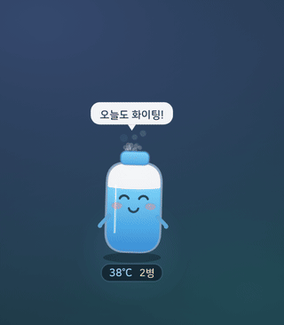
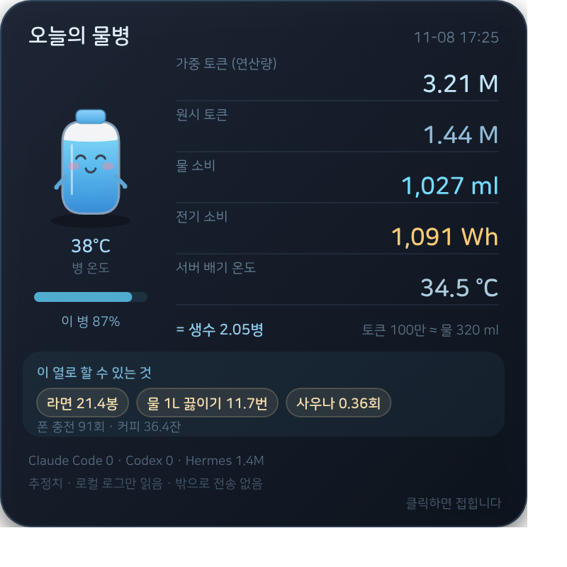

# 🧴 Aquabyte (아쿠아바이트)

**AI를 쓸수록 물이 증발하는 macOS 데스크톱 캐릭터.**
Your AI's water footprint, as a thirsty little bottle on your desktop.



---

## 설치 (한 줄)

```bash
curl -fsSL https://raw.githubusercontent.com/chaympress/aquabyte/main/install.sh | bash
```

- 화면 오른쪽 아래에 물병이 뜹니다 (테두리 없음 · 항상 맨 앞)
- **옮기기**: 물병을 잡고 드래그
- **닫기**: 마우스를 올리면 나오는 ✕
- **자세히**: 물병을 클릭

**필요한 것**: macOS · python3 · Xcode Command Line Tools (`xcode-select --install`)

---

## 무엇을 하나

- Claude Code, Codex, Hermes를 쓰면 **물이 줄고 온도가 올라갑니다**
- 토큰이 늘면 **초록 코드가 비처럼** 내립니다
- 물 500 ml를 다 쓰면 **눈이 X자가 되며 뻗고**, 새 병이 떨어집니다
- 매일 **현지 00:00** 에 새 병으로 리셋됩니다
- 클릭하면 오늘 쓴 **물 · 전기 · 토큰**과 재밌는 환산이 나옵니다



---

## 숫자를 어디서 읽나

이 앱은 **API도, 로그인도 쓰지 않습니다.** 이미 컴퓨터에 쌓이는 기록을 읽습니다.

| 도구 | 읽는 곳 |
|---|---|
| Claude Code | `~/.claude/projects/**/*.jsonl` |
| Codex CLI | `~/.codex/sessions/**/*.jsonl` |
| Hermes | `~/.hermes/state.db` |

- **0.5초마다** 새로 추가된 줄만 읽습니다 (증분 읽기, 1회 0.09초)
- 로그 파일이 자라는 순간을 감지해서, 응답이 끝나기 전에도 반응합니다

---

## 프라이버시

- **로컬 파일만 읽습니다. 어디로도 보내지 않습니다.**
- 대화 내용은 읽지 않습니다. **토큰 숫자 필드만** 셉니다.
- 네트워크 서버를 열지 않습니다 (위젯은 `file://` 로 동작)

---

## 계산 방식 (모두 추정치)

가중 토큰 = `input×1 + cache_read×0.1 + cache_write×1.25 + output×5`
(Anthropic 공개 가격 비율을 연산 비례로 사용)

- 물 **0.32 ml** / 1,000 가중토큰
- 전기 **0.34 Wh** / 1,000 가중토큰

근거: OpenAI가 공개한 "질의 1회 = 0.34 Wh, 0.000085 gal(≈0.32 ml)" 값을 토큰 단위로 환산.
토큰 수는 로그에서 센 **실측**이고, 물·전기는 그 값에 계수를 곱한 **환산**입니다.

---

## 지원

- **macOS** (Apple Silicon · Intel)
- Windows / Linux: 아직 지원하지 않습니다

---

## 삭제

```bash
pkill -f aquabyte-pet
rm -rf ~/aquabyte ~/.aquabyte-cache.json ~/.ai-bottle-cache.json
```

---

## English

**Aquabyte** is a tiny bottle that lives in the corner of your macOS desktop.
It evaporates as you burn AI tokens, glows red as your session heats up,
and faints when the bottle is empty.

```bash
curl -fsSL https://raw.githubusercontent.com/chaympress/aquabyte/main/install.sh | bash
```

Reads local logs only (`~/.claude`, `~/.codex`, `~/.hermes`). Nothing is sent anywhere.
Water and power figures are estimates derived from published per-query numbers.

MIT License.
