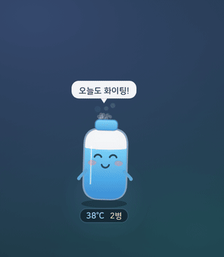
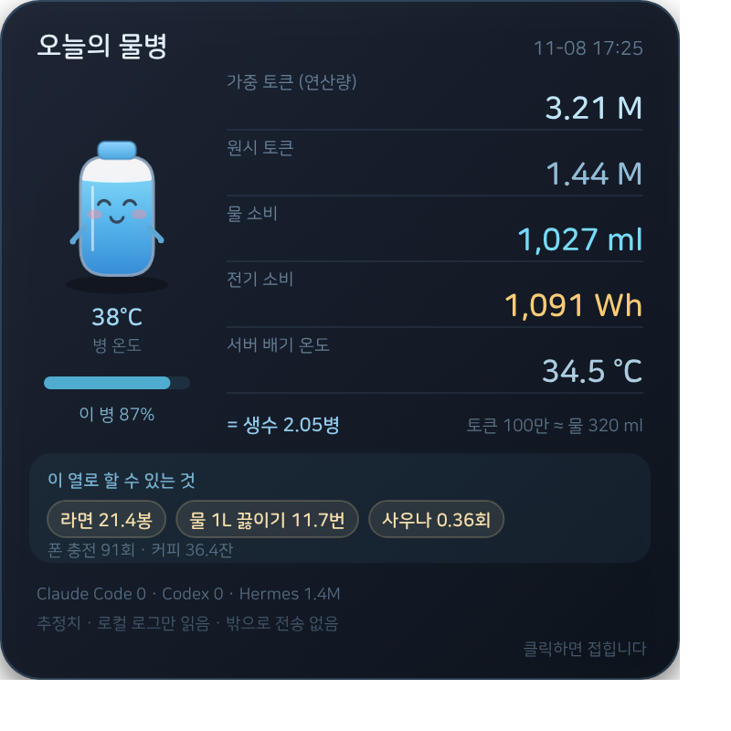

# 🧴 Aquabyte

**A tiny bottle that lives on your macOS desktop and evaporates as you burn AI tokens.**

[한국어 안내](README.ko.md)



---

## Install

```bash
curl -fsSL https://raw.githubusercontent.com/chaympress/aquabyte/main/install.sh | bash
```

The installer downloads the source, compiles it locally with `swiftc`, and launches the widget.
Nothing is signed or notarized because nothing is shipped as a prebuilt app — it is built on your machine.

**Requirements**: macOS · `python3` · Xcode Command Line Tools (`xcode-select --install`)

---

## What it does

- Sits in the bottom-right corner. **Frameless**, always on top, no Dock icon
- **Drag** the bottle to move it · **hover** to reveal ✕ · **click** for details
- Water drops and temperature rises as you use Claude Code, Codex or Hermes
- When tokens increase, **green code rains down** over the character
- When the 500 ml bottle runs dry it **faints** — and a new one drops in
- Resets to a full bottle at **local 00:00**
- The detail panel shows today's water, power and tokens, plus fun conversions



---

## Where the numbers come from

Aquabyte uses **no API and no login**. It reads the usage logs your tools already write.

| Tool | Read from |
|---|---|
| Claude Code | `~/.claude/projects/**/*.jsonl` |
| Codex CLI | `~/.codex/sessions/**/*.jsonl` |
| Hermes | `~/.hermes/state.db` |

- Only newly appended lines, checked every 0.5 s (about 0.09 s per pass)
- A growing log file counts as "the AI is working", so the character reacts
  before the token totals are final

**Not supported**: web chatbots (ChatGPT, Claude web, Perplexity) keep no local log.

---

## Privacy

- **Reads local files only. Sends nothing anywhere.**
- Never reads message content — only the numeric token fields
- Opens no network server. The widget runs from `file://`

---

## How the estimate works (all approximate)

```
weighted tokens = input×1 + cache_read×0.1 + cache_write×1.25 + output×5
```

Weights follow public price ratios, used as a proxy for compute.

- Water: **0.32 ml** per 1,000 weighted tokens
- Power: **0.34 Wh** per 1,000 weighted tokens

Derived from OpenAI's published figure: one query ≈ 0.34 Wh and 0.000085 gal (≈0.32 ml).

Token counts are **measured** from your logs. Water and power are **estimates** derived from them.

---

## Support

- macOS (Apple Silicon and Intel)
- Windows / Linux: not supported yet

---

## Uninstall

```bash
pkill -f aquabyte-pet
rm -rf ~/aquabyte ~/.aquabyte-cache.json
```

---

MIT License.
